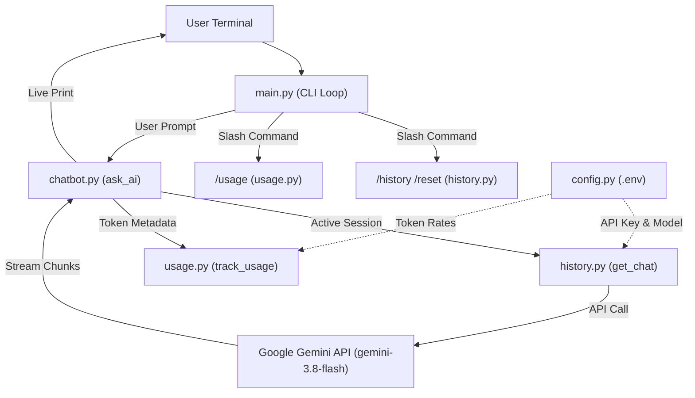

# 🤖 Gemini Python CLI Chatbot

A modular, production-ready terminal chatbot powered by Google Gemini and built with Python. Features real-time token streaming, multi-turn conversational memory, command-driven session control, and live token & cost tracking.

---

## 📚 What This Project Covers

This project is a hands-on, practical implementation of building an AI-powered conversational agent using the modern **Google GenAI SDK** (`google-genai`). Key concepts covered:

1. **Google GenAI SDK Integration**:
   - Initializing and configuring `genai.Client` with API key authentication and custom system prompts.
   - Dynamic model selection via environment variables (defaulting to `gemini-3.8-flash`).

2. **Real-time Response Streaming (`send_message_stream`)**:
   - Yielding response chunks on-the-fly rather than blocking until the full text generates.
   - Immediate terminal rendering using unbuffered stdout (`flush=True`) for a smooth typing effect.

3. **Multi-Turn Context & History Management**:
   - Maintaining persistent chat sessions across user prompts with `client.chats.create`.
   - **Stream chunk aggregation**: Merging fragmented streaming chunks into clean, readable turn-by-turn dialogue.
   - **Thought token filtering**: Automatically stripping internal reasoning blocks (`thought=True`) from modern Gemini models so only user-facing responses are preserved.

4. **Token Analytics & Cost Calculation**:
   - Extracting live prompt and candidate token counts from `chunk.usage_metadata`.
   - Real-time cost estimation per request and cumulative session totals based on configurable per-1M token rates.

5. **CLI Application Architecture**:
   - Clean command-loop pattern with slash commands (`/history`, `/reset`, `/usage`, `/exit`).
   - Graceful interrupt handling for `Ctrl+C` (`KeyboardInterrupt`) and `Ctrl+D` (`EOFError`).

6. **Environment & Security Best Practices**:
   - Safe API credential loading via `python-dotenv`.
   - Complete `.env.example` template and pre-configured `.gitignore` to prevent credential leakage.

---

## 💡 Example Questions & Interactions

Here is how you can interact with the chatbot in your terminal:

### 1. Conceptual Coding Question
```text
You: Explain Python decorators in simple terms with an example.

AI: A decorator in Python is a function that takes another function as an input,
adds some behavior to it, and returns the modified function without changing the
original function's code.

Here is a practical example:

def timer(func):
    def wrapper(*args, **kwargs):
        print("Starting task...")
        result = func(*args, **kwargs)
        print("Task finished!")
        return result
    return wrapper

@timer
def say_hello():
    print("Hello, world!")

say_hello()

--- Request Usage ---
Input tokens: 36
Output tokens: 104
Request cost: $0.00003390
```

### 2. Follow-Up Question (Multi-Turn Memory)
```text
You: Can you rewrite that so it preserves the original function's metadata?

AI: Absolutely! You can use `functools.wraps` to preserve the original function's name, docstring, and annotations:

from functools import wraps

def timer(func):
    @wraps(func)
    def wrapper(*args, **kwargs):
        ...
```

### 3. Reviewing Conversation History (`/history`)
```text
You: /history

USER: Explain Python decorators in simple terms with an example.

AI: A decorator in Python is a function that takes another function as an input...

USER: Can you rewrite that so it preserves the original function's metadata?

AI: Absolutely! You can use `functools.wraps`...
```

### 4. Viewing Session Usage (`/usage`)
```text
You: /usage

--- Session Usage ---
Input tokens: 182
Output tokens: 246
Total cost: $0.00008745
```

### 5. Clearing Context (`/reset`)
```text
You: /reset
Conversation history cleared.
```

---

## 🏗️ Architecture & Component Flow



---

## 📁 Project Structure

```text
ai-cli-chatbot/
├── chatbot.py          # Gemini API streaming, response rendering, and error handling
├── config.py           # Environment loading, API key validation, and token rates
├── history.py          # Session initialization, history aggregation, and system prompt
├── usage.py            # Token consumption calculation and cost reporting
├── main.py             # CLI interactive loop, command dispatcher, and signal handling
├── requirements.txt    # Python dependencies (google-genai, python-dotenv)
├── .env.example        # Environment variable template
├── .gitignore          # Security rules preventing secrets and venvs from being pushed
└── README.md           # Documentation and guides
```

---

## 🚀 Getting Started

### Prerequisites

- **Python 3.10+**
- A **Gemini API Key** from [Google AI Studio](https://aistudio.google.com/)

### 1. Clone the Repository

```bash
git clone https://github.com/JainAditi09/ai-cli-chatbot.git
cd ai-cli-chatbot
```

### 2. Set Up a Virtual Environment

**On macOS / Linux:**
```bash
python3 -m venv venv
source venv/bin/activate
```

**On Windows:**
```cmd
python -m venv venv
venv\Scripts\activate
```

### 3. Install Dependencies

```bash
pip install -r requirements.txt
```

### 4. Configure Environment Variables

Create your `.env` file from the provided template:
```bash
cp .env.example .env
```

Edit `.env` with your API key:
```env
GEMINI_API_KEY=your_actual_gemini_api_key_here
GEMINI_MODEL=gemini-3.8-flash

# Model rates in USD per 1,000,000 tokens
INPUT_PRICE_PER_1M=0.075
OUTPUT_PRICE_PER_1M=0.30
```

---

## 💬 Command Reference

| Command | Action |
| :--- | :--- |
| `/history` | Displays clean, aggregated conversation history of the current session. |
| `/reset` | Resets conversation context and clears memory for a fresh session. |
| `/usage` | Displays cumulative session token counts and cost estimates. |
| `/exit` | Exits the chatbot (or press `Ctrl+C` / `Ctrl+D`). |

---

## 📄 License

This project is licensed under the [MIT License](LICENSE).
