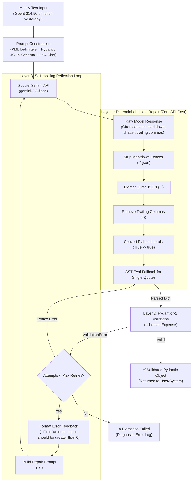

# 📑 Day 2 — Prompting and Structured Outputs

A hands-on, production-grade guide to extracting **reliable, machine-readable structured data** from messy, unstructured text using Google Gemini, Pydantic v2, and deterministic self-healing loops.

---

## 🎯 Learning Objectives

By the end of Day 2, you will understand:
1. **Prompt Patterns**: Delimiters, XML tag structuring, negative constraints, and zero-shot vs few-shot prompting.
2. **Schema as Code**: Dynamically injecting JSON Schemas directly from Pydantic models.
3. **Pydantic v2 Validation**: Field constraints, automatic normalization, and custom `@field_validator` hooks.
4. **Local Deterministic Repair**: Fixing common LLM syntax bugs (markdown fences, trailing commas, Python literals) for **$0.00 and 0.1ms latency**.
5. **Self-Healing Reflection Loop**: Feeding exact validation error traces back to Gemini to self-correct when data is invalid.
6. **CLI Chatbot Integration**: Extending `main.py` with the `/extract` command.

---

## 🏗️ The 4-Layer Defense Architecture

When extracting structured outputs from LLMs in production, you should never trust raw text generation blindly. Our architecture implements a **multi-stage defensive pipeline**:



---

## 🧠 Core Concepts Explained Simply

### 1. XML Tag Delimiters
LLMs parse structured prompts significantly better when distinct sections are wrapped in XML-style tags. Instead of writing unstructured instructions, we wrap our prompts:

```xml
<instructions>
Extract structured data. Output ONLY valid JSON conforming to the schema.
</instructions>

<schema>
{ ... Pydantic JSON Schema ... }
</schema>

<examples>
Input: "Paid $42.50 for lunch on 10/11/2026"
Output: {"title": "Lunch", "amount": 42.5, "currency": "USD", "date": "2026-11-10"}
</examples>

<input_text>
Had coffee with Sam yesterday, bill was $8.50.
</input_text>
```

**Why this works:**
- Eliminates ambiguity between system instructions and user input.
- Prevents prompt injection (where user text mimics system instructions).
- Makes the input-output mapping crystal clear.

---

### 2. Pydantic v2 as the Schema Contract (`schemas.py`)
Rather than maintaining separate documentation or hand-written JSON schemas, Pydantic models act as the single source of truth:

```python
class Expense(BaseModel):
    title: str = Field(..., min_length=1, description="What was purchased")
    amount: float = Field(..., gt=0, description="Cost (must be > 0)")
    currency: str = Field(default="USD", description="3-letter code")
    category: str = Field(default="General", description="Expense category")
    date: str = Field(..., description="Date in YYYY-MM-DD")
```

#### Smart Field Normalization with `@field_validator(mode="before")`:
Instead of failing when a user writes `$` or `Nov 12, 2026`, Pydantic normalizes values before validation:
- `$` → `USD`
- `€` → `EUR`
- `₹` → `INR`
- `Nov 12, 2026` → `2026-11-12`
- `25/11/2026` → `2026-11-25`

---

### 3. Local Deterministic Repair (`repair.py`)
Why spend time and API money re-calling an LLM when a regex can fix the output in 0.1 milliseconds?

Our `repair_json()` utility handles the most common LLM syntax quirks:
| LLM Flaw | Example Output | Deterministic Fix Applied |
| :--- | :--- | :--- |
| **Markdown Fences** | ```` ```json {"a": 1} ``` ```` | Regex strips ```` ```json ```` and closing ```` ``` ```` |
| **Conversational Chatter** | `Here is your JSON:\n{"a": 1}\nHope this helps!` | Extracts outer matching braces `{...}` |
| **Trailing Commas** | `{"items": [1, 2, ], "total": 10, }` | Strips `,` preceding `}` or `]` |
| **Python Literals** | `{"active": True, "notes": None}` | Converts `True` → `true`, `None` → `null` |
| **Single Quotes** | `{'title': 'Coffee', 'amount': 4.5}` | Safely parses via `ast.literal_eval` fallback |
| **Unquoted Keys** | `{ title: "Lunch" }` | Quotes identifiers preceding colons `{ "title": "Lunch" }` |
| **Comments** | `// tax excluded\n{"a": 1}` | Strips single-line (`//`) and multi-line (`/* */`) comments |

---

### 4. Self-Healing Reflection / Retry Loop (`extractor.py`)
When deterministic repair is not enough (e.g., negative amount, hallucinated schema, missing required fields), the extractor enters a retry loop:

1. Catch `pydantic.ValidationError` or `json.JSONDecodeError`.
2. Extract the exact failure details:
   ```text
   - Field 'amount': Input should be greater than 0
   - Field 'date': Field required
   ```
3. Send a **targeted repair prompt** back to Gemini:
   ```xml
   <instructions>
   Your previous output failed validation. Fix ONLY these errors:
   </instructions>
   <validation_errors>
   - Field 'amount': Input should be greater than 0
   </validation_errors>
   <invalid_output>
   {"title": "Refund", "amount": -14.50, ...}
   </invalid_output>
   ```
4. Gemini inspects its mistake, self-corrects, and outputs a valid object on attempt 2!

---

## 🎤 Interview Drills & Deep-Dive Answers

### Question 1: What makes output reliably machine-readable?

> **Comprehensive Answer:**
> Reliably machine-readable output requires a defense-in-depth approach across four fundamental pillars:
>
> 1. **Constrained Decoding & Grammar Enforcement (Inference Level)**:
>    - Modern model engines support constrained generation (Logit masking / Context-Free Grammars like Outlines or Gemini's `response_schema`).
>    - At every token generation step, the model masks out any tokens that would violate the JSON grammar or target schema, guaranteeing that syntax errors are mathematically impossible.
>
> 2. **Explicit Schema Contracts (Application Level)**:
>    - Rather than asking in natural language ("give me JSON"), you provide an authoritative schema (JSON Schema derived from Pydantic v2).
>    - Field descriptions, exact data types, and value constraints (e.g. `gt=0`, ISO-8601 regexes) constrain the solution space.
>
> 3. **Prompt Boundary Engineering (Prompt Level)**:
>    - Delimiters (XML tags like `<schema>`, `<input_text>`) prevent prompt ambiguity.
>    - Negative constraints ("Do not output markdown code blocks or preambles") suppress conversational tendencies.
>    - Few-shot canonical examples anchor the model's pattern matching.
>
> 4. **Defensive Post-Processing & Validation Guardrails**:
>    - Deterministic sanitizers (stripping fences, extracting outer JSON blocks).
>    - Strong type validation via Pydantic or Zod.
>    - Active feedback loops (self-healing retries) that treat the LLM as an iterative collaborator rather than an infallible one-shot oracle.

---

### Question 2: How do you recover from malformed JSON?

> **Comprehensive Answer:**
> In production systems, recovering from malformed JSON should follow a **tiered recovery funnel** ordered from lowest cost & latency to highest:
>
> ```text
> Raw Output
>    │
>    ▼ [Tier 1: Zero-Touch Parse]
> Standard json.loads() ──────────────────────► Valid? ──► Return
>    │ (Fails)
>    ▼ [Tier 2: Deterministic Local Sanitization]
> Strip fences, extract outer block, ─────────► Valid? ──► Return
> remove trailing commas, fix Python literals,
> ast.literal_eval fallback
>    │ (Fails)
>    ▼ [Tier 3: Error-Conditioned Reflection Loop]
> Format exact syntax/Pydantic error diff ─────► Valid? ──► Return
> and request model self-correction
>    │ (Fails after max_retries)
>    ▼ [Tier 4: Circuit Breaker & Fallback]
> Return structured failure result, log diagnostics, or route to human review.
> ```
>
> **Why this multi-tier order matters:**
> - **Tier 1 & 2** resolve 85-90% of real-world formatting errors locally with **0 tokens consumed and sub-millisecond latency**.
> - **Tier 3** resolves semantic errors (e.g. invalid dates, negative prices, missing fields) by focusing the LLM on its specific error rather than regenerating from scratch.
> - **Tier 4** prevents infinite loops and uncontrolled API spending by enforcing strict retry bounds.

---

## 💻 Code Structure for Day 2

```text
ai-cli-chatbot/
├── schemas.py           # Pydantic models (Expense, TaskItem) with field & normalization validators
├── repair.py            # Zero-cost deterministic JSON sanitizer and regex recovery engine
├── prompt_templates.py  # Structured XML prompt patterns, JSON schema injection, and error reflection
├── extractor.py         # MessyTextExtractor class with repair pipeline and self-healing retry loop
├── demo_day2.py         # Beginner-friendly interactive demo walkthrough
├── tests/
│   └── test_day2.py     # 20 comprehensive unit tests covering schemas, repairs, and retry loops
├── main.py              # Extended CLI chatbot with new '/extract' command
├── requirements.txt     # Updated with pydantic>=2.0.0
└── day2.md              # Complete tutorial, architecture reference, and interview drills
```

---

## 🧪 Running the Tests & Demos

### 1. Run the Test Suite (20 Tests in < 0.01s)
Run standard Python `unittest`:
```bash
./venv/bin/python -m unittest discover tests
```

Output:
```text
....................
----------------------------------------------------------------------
Ran 20 tests in 0.009s

OK
```

### 2. Run the Interactive Beginner Demo
```bash
./venv/bin/python demo_day2.py
```
This demonstrates:
1. Pydantic schema validation & normalization
2. Local deterministic repair (markdown fences + trailing commas)
3. Simulated self-healing retry loop (correcting negative numbers)
4. Live Gemini API extraction

### 3. Use the Interactive CLI Chatbot
Start the chatbot:
```bash
./venv/bin/python main.py
```

Type `/extract` and paste any messy note:
```text
You: /extract

---------------------------------------------
  DAY 2: STRUCTURED DATA EXTRACTOR
---------------------------------------------
Paste unstructured messy text (e.g. receipt, note, or expense):
Example: 'Paid $18.50 for airport taxi on 12/11/2026, travel expense'

Messy Text > Grabbed lunch at Subway with Sarah yesterday, paid $14.20 on card. Mark under food.

Extracting and validating Pydantic object...

✅ Extraction Successful!
Attempts needed: 1

Validated Pydantic Object:
{
  "title": "Lunch at Subway with Sarah",
  "amount": 14.2,
  "currency": "USD",
  "category": "Food",
  "date": "2026-11-12"
}
```

---

## 🔑 Key Takeaways for Day 2

1. **Schemas are Contracts**: Use Pydantic to strictly define expectations.
2. **Normalize Early**: Use `mode="before"` field validators so common variations (`$`, human dates) don't trigger unnecessary errors.
3. **Repair Before Retrying**: Deterministic string sanitization solves markdown and syntax quirks with zero API latency and zero cost.
4. **Retry with Concrete Feedback**: When retrying, send the model the exact Pydantic validation error so it knows what to fix.
5. **Always Bound Retries**: Use a hard limit (`max_retries=3`) to prevent runaway API costs.
